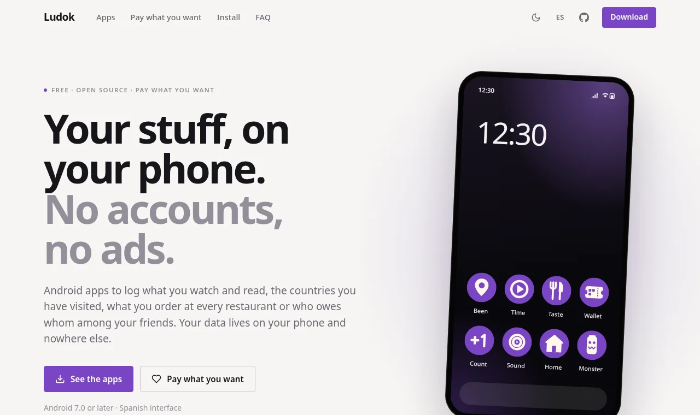

<div align="center">

# Ludok Apps Web

**The website for the Ludok Android apps.**

A catalog, one page per app, an install guide and "pay what you want" through Ko-fi.<br>
In Spanish (`/`) and English (`/en/`). Static, with no third-party JavaScript and no cookies.

[](LICENSE)
[](https://astro.build/)
[](https://www.typescriptlang.org/)
[](https://iamludok.github.io/ludok-apps-web/)

[Website](https://iamludok.github.io/ludok-apps-web/) · [Development](#development) · [Common Tasks](#common-tasks) · [Publishing](#publishing)

<br>



</div>

---

## Development

```bash
npm install
npm run dev       # http://localhost:4321
npm run check     # types
npm run build     # → dist/
```

You need Node 22.22 or later.

Same "Sala oscura" style and same base as the Ludok Sound website.

## Where Things Go

```
src/site.ts           links, routes and KOFI_URL
src/i18n.ts           every text on the site, except each app's own
src/apps/<app>.ts     each app: texts in both languages, repo, whether it can be downloaded, whether it takes payments
src/apps/index.ts     the list and order of the apps
src/lib/releases.ts   each app's latest release, read from GitHub at build time
src/components/       page templates (Home, AppPage, InstallPage, PrivacyPage) and pieces
public/img/<app>/     screenshots
scripts/og.html       the share image (public/og.png)
```

## Common Tasks

- **Ko-fi**: set your page in `KOFI_URL` (`src/site.ts`). While it's `null`, payment buttons don't
  show up on the published site, and a warning shows in their place locally.
- **Publishing an app shown as "Coming soon"**: publish its release with the APK on GitHub and set
  `available: true` in `src/apps/<app>.ts`. Version, size, date and the direct APK link come from
  the release automatically.
- **A new version of an app**: nothing to do. The Action rebuilds the site every day and picks up
  the latest release.
- **Screenshots**: 600×1228 WebP, cropped without the status bar, in `public/img/<app>/`, plus an
  entry in the app file's `shots` with its title and text. The first three fan out in the page
  header; with two or more, the page gets the walkthrough (a pinned phone that changes screen as
  you scroll). The first two of each app also appear in the home page strip.
- **Ludok Monster 3D**: `npm run assets:monster` reads the app (`../Ludok Monster`, without
  touching it), places the tower with the app's own code and copies only the models and labels it
  needs to `public/monster3d/`. Run it again when the app gets new cans.
- **Adding an app**: copy a file in `src/apps/`, add it to `src/apps/index.ts`, and add its icon
  (the content of `logo/<app>.svg`, without the background) to `src/components/AppIcon.astro`.
- **Share image**: after changing `scripts/og.html`, regenerate it with
  `chromium-browser --headless=new --hide-scrollbars --window-size=1200,630 --screenshot=public/og.png scripts/og.html`.

## Publishing

`.github/workflows/deploy.yml` publishes to GitHub Pages on every push to `main`, by hand, and once
a day. In the repo: Settings → Pages → Source: GitHub Actions. It's served at
`https://iamludok.github.io/ludok-apps-web/`; with a custom domain, only the Pages settings need to
change.

## License

The code is distributed under the **MIT License**. See [LICENSE](LICENSE) for the full text.

The Monster Energy can labels and models in `public/monster3d/` are not covered by the license:
"Monster Energy" and its can designs are trademarks of their owners.

---

<div align="center">

Made by [Luken Iriondo](https://iamludok.github.io/)

</div>
